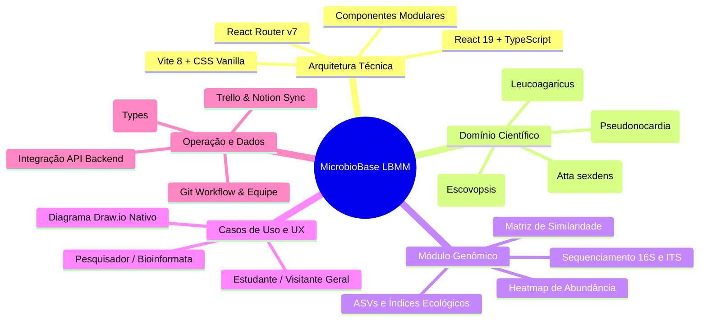

# 🌿 MicrobioBase - Fungus Garden Web Front
> **Laboratório:** LBMM / UNESP (Laboratório de Bioquímica e Microbiologia Molecular)  
> **Repositório:** `Lab-LBMM/fungus_garden_web_front`  
> **Branch Principal de Dev:** `feature/kaua/pagina_comparacao_seq_runs`  
> **Quadro no Trello:** [MicrobioBase - Fungus Garden](https://trello.com/b/A6oQEd7i/microbiobase-fungus-garden)

---

## 🧭 Mapa de Navegação da Base de Conhecimento

### 📚 Notas Especializadas do Projeto:
1. [[01 - Arquitetura Técnica e Frontend]]: Stack, componentes, rotas, performance e estilização.
2. [[02 - Domínio Científico e Biológico]]: Ecologia das formigas-cortadeiras, mutualismo quadripartido e metagenômica.
3. [[03 - Módulo de Sequenciamento e Comparador de Seq Runs]]: Documentação detalhada da `CompareSeqRunsPage` e bioinformática.
4. [[04 - Modelagem de Dados e Tipos TypeScript]]: Interfaces, esquemas de dados, mocks atuais e contrato da API futura.
5. [[05 - Guia do Desenvolvedor e Git Workflow]]: Padrões de branch, higiene de commit, testes locais e sincronização.
6. [[06 - Diagrama de Casos de Uso e Atores]]: Modelagem UML completa e referência ao arquivo nativo `Diagrama_Casos_de_Uso.drawio`.
7. [[Notion_MicrobioBase_LBMM]]: Estrutura completa pronta para importação no workspace do Notion.

---

## 🎯 Propósito Central do Projeto

O **MicrobioBase** é uma plataforma web científica interativa concebida para centralizar, visualizar e comparar dados ecológicos, taxonômicos, genômicos e de sequenciamento de amplicons gerados nas pesquisas do **LBMM/UNESP**.

O foco de estudo primário reside no **sistema mutualista complexo das formigas da tribo Attini** (formigas-cortadeiras e agrícolas basais) e suas relações ecológicas com:
1. **O fungo cultivado** (*Leucoagaricus gongylophorus*), que degrada matéria vegetal para alimentar a colônia;
2. **Micro-parasitas fúngicos especializados** (como *Escovopsis*), que atacam o jardim de fungo;
3. **Bactérias actinomicetos mutualistas** (como *Pseudonocardia* e *Streptomyces*), mantidas na cutícula das formigas para produzir antibióticos naturais contra os patógenos do jardim;
4. **Comunidades microbianas associadas** caracterizadas por sequenciamento de nova geração (NGS) de regiões hipervariáveis do 16S rRNA e ITS.

---

## 👥 Equipe do Laboratório (LBMM)

| Nome | Função / Cargo | Área de Atuação |
| :--- | :--- | :--- |
| **Dr. André Rodrigues** | Coordenador Principal / Prof. Titular | Micologia, Interações Inseto-Fungo, Filogenia Molecular |
| **Dra. Maria Fernanda Silva** | Pesquisadora Pós-Doutorado | Actinobactérias, Triagem Antimicrobiana e Metabolômica |
| **Dr. Lucas Gabriel Santos** | Pesquisador Pós-Doutorando | Basidiomycota, Ecologia Evolutiva e Enzimologia |
| **Me. Beatriz Oliveira** | Doutoranda | Microbiologia e Simbiose em Formigas Cortadeiras |
| **Kauã Henrique** | Desenvolvedor Frontend | Desenvolvimento da SPA, Módulo de Sequenciamento e UX |
| **Isabelly** | Desenvolvedora Frontend / Colaboradora | Módulo de Mapa de Calor de Seq Runs |

---

## 📈 Resumo do Status Atual (Snapshot)
- **Front-end SPA:** 100% navegável com 8 rotas operacionais.
- **Destaque Atual:** Desenvolvimento do comparador matricial multiamostral de ASVs (`CompareSeqRunsPage.tsx`).
- **Autoria do Git:** Padronizada com sucesso em `Kauã Henrique <kauaestudosprog@gmail.com>`.
- **Arquitetura de Documentação:** Tríade sincronizada entre **Obsidian**, **GitHub** (`docs/`) e **Trello**.
