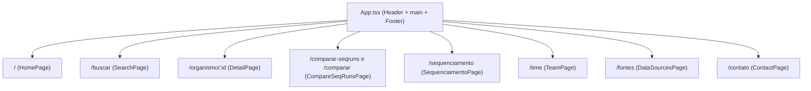

# 💻 Arquitetura Técnica e Frontend

Nota anterior: [[00 - Visão Geral e Mapa Mental]] | Próxima nota: [[02 - Domínio Científico e Biológico]]

---

## 🛠️ Stack Tecnológica

| Camada / Ferramenta | Versão | Propósito |
| :--- | :--- | :--- |
| **React** | `19.2.6` | Biblioteca central de renderização de componentes com novo compilador e hooks concorrentes |
| **TypeScript** | `~6.0.2` (strict mode) | Tipagem estática rigorosa para dados biológicos, metadados e ASVs |
| **Vite** | `8.0.12` | Bundler e servidor de desenvolvimento ultra-rápido com HMR (*Hot Module Replacement*) |
| **React Router DOM** | `7.18.0` | Gerenciamento de rotas declarativas de SPA |
| **Lucide React** | `1.17.0` | Pacote de ícones SVG vetorizados e responsivos |
| **ESLint** | `10.3.0` | Linter estático com regras para React Hooks e TypeScript |
| **CSS Modular Vanilla** | Nativo | Estilos escopados por página/componente com Design Tokens centralizados |

---

## 🗺️ Mapa de Rotas e Navegação (`App.tsx`)

O roteamento é centralizado em [App.tsx](file:///C:/Users/k246165/Documents/system/fungus_garden_web_front/src/App.tsx):



### Detalhamento das Páginas:

1. **`HomePage` (`/`)**:
   - `Hero`: Campo de busca rápido que redireciona para `/buscar?q=termo`.
   - `StatsBar`: Indicadores numéricos consolidados (organismos, fungos, bactérias, referências).
   - `MorphologyFilter`: Grade com tipos de agricultura das formigas (Basal, Levedura, Derivada, Fungos Corais).
   - `FeaturedOrganisms`: Cards em destaque dos microrganismos e hospedeiros mais relevantes.
   - `AboutSection` & `CTASection`: Seções institucionais com chamadas de ação.

2. **`SearchPage` (`/buscar`)**:
   - Motor de busca e catálogo principal.
   - Filtros taxonômicos hierárquicos interativos (`TaxonomyFilter`).
   - Seleção customizada via `SearchableSelect`.
   - Renderização de lista/grid de organismos com `OrganismCard`.

3. **`DetailPage` (`/organismo/:id`)**:
   - Visualização científica do espécime selecionado.
   - Anel SVG de proporção GC/AT calculado em tempo real.
   - Informações genômicas (Tamanho do genoma, contagem de genes CDS, acesso GenBank).
   - Hierarquia taxonômica completa com ícones contextuais para cada rank biológico.
   - Relações ecológicas associadas (formigas hospedeiras, bactérias e fungos simbiontes).

4. **`SequenciamentoPage` (`/sequenciamento`)**:
   - Painel analítico de corridas de sequenciamento NGS e genômica comparada.
   - Abas:
     - `seqruns`: Lista de corridas metagenômicas com cards descritivos, índices alfa (Shannon, Chao1) e preview de ASVs.
     - `tabela`: Tabela de registros genômicos com plataformas (NovaSeq, Nanopore, PacBio) e cobertura.
     - `diretrizes`: Protocolos e padrões do laboratório para submissão de sequências.

5. **`CompareSeqRunsPage` (`/comparar-seqruns`)**:
   - Módulo bioinformático avançado com heatmap matricial multiamostral, similaridade ecológica e exportadores. *(Ver detalhes em [[03 - Módulo de Sequenciamento e Comparador de Seq Runs]])*.

6. **`TeamPage` (`/time`)**, **`DataSourcesPage` (`/fontes`)** e **`ContactPage` (`/contato`)**:
   - Páginas institucionais, corpo de pesquisadores, lista de bancos de dados parceiros (NCBI, UniProt, MycoBank, AntWeb) e canal de comunicação.

---

## 🎨 Design System e Estilização (`src/styles/global.css`)

O projeto utiliza uma paleta de cores botânica inspirada em micologia e microbiologia florestal:

```css
:root {
  /* Tons Principais da Marca */
  --green-primary: #1a7a4a;   /* Verde Floresta Institucional */
  --green-dark:    #145e38;   /* Verde Escuro para Hover/Foco */
  --green-light:   #e8f5ee;   /* Fundo Suave para Badges e Containers */
  --green-accent:  #27ae60;   /* Verde Vibrante para Destaques */
  --green-muted:   #6dbf8a;   /* Verde Claro para Bordas e Linhas */

  /* Cores Neutras */
  --white:         #ffffff;
  --off-white:     #f8faf9;
  --gray-100:      #f1f5f2;
  --gray-200:      #e2eae5;
  --gray-400:      #9aafa2;
  --gray-600:      #5a706a;
  --gray-800:      #1e2d28;

  /* Tipografia */
  --font-display:  'Playfair Display', Georgia, serif; /* Títulos e Hero */
  --font-body:     'DM Sans', system-ui, sans-serif;  /* Textos e Dados */

  /* Raios e Sombras */
  --radius-sm: 6px;
  --radius-md: 12px;
  --radius-lg: 20px;
  --radius-xl: 32px;
  --shadow-sm: 0 1px 4px rgba(26,42,32,0.08);
  --shadow-md: 0 4px 16px rgba(26,42,32,0.1);
  --shadow-lg: 0 8px 32px rgba(26,42,32,0.12);
}
```

---

## ⚡ Performance e Ciclo de Renderização

- **`useMemo` em Operações Matriciais:** O cruzamento de dados entre amostras em `CompareSeqRunsPage` e a hierarquia de `TaxonomyFilter` são encapsulados em `useMemo`, prevenindo recálculos pesados durante a digitação de buscas.
- **Scroll Inteligente:** Navegação limpa com `window.scrollTo({ top: 0, behavior: 'smooth' })` ao mudar de rota via `Header` ou `Footer`.
- **Prevenção de Render Desnecessário:** Componentes puros em cards e itens com tipagem discriminada (`type: 'Bacteria' | 'Fungo' | 'Formiga'`).
