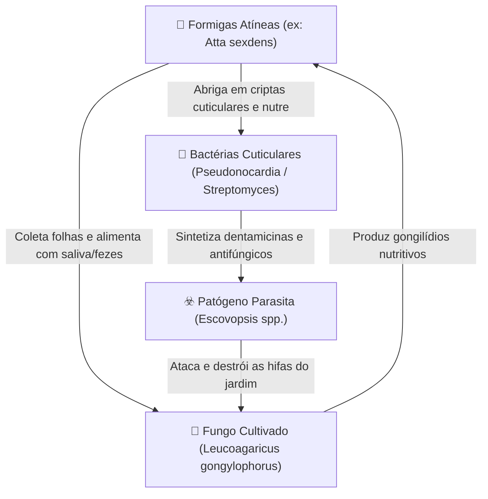

# 🐜 Domínio Científico e Biológico

Nota anterior: [[01 - Arquitetura Técnica e Frontend]] | Próxima nota: [[03 - Módulo de Sequenciamento e Comparador de Seq Runs]]

---

## 🔬 O Sistema Simbiótico das Formigas Atíneas (Attini)

As pesquisas conduzidas pelo **LBMM/UNESP** investigam um dos exemplos mais sofisticados de coevolução e mutualismo multipartido da natureza: a **agricultura praticada pelas formigas da tribo Attini**.

Esse sistema não é apenas uma relação entre um inseto e um fungo; trata-se de uma rede ecológica multipartida composta por quatro atores principais:



---

## 🌾 Os Sistemas Agrícolas das Formigas Cultivadoras

No `MorphologyFilter.tsx` e na modelagem de dados do sistema, as formigas e seus fungos são categorizados de acordo com o nível evolutivo de sua agricultura:

1. **Agricultura Basal (*Lower Agriculture*):**
   - Espécies mais antigas de formigas atíneas cultivam fungos de vida livre que ainda são capazes de sobreviver fora do formigueiro.
2. **Agricultura de Levedura (*Yeast Agriculture*):**
   - O fungo é mantido em uma fase unicelular de levedura em vez de micélio filamentoso.
3. **Agricultura de Fungos Corais (*Coral Fungus Agriculture*):**
   - Cultivo de fungos pteruláceos com formato semelhante a pequenos corais ramificados.
4. **Agricultura Derivada / Superior (*Higher Agriculture*):**
   - Fungos altamente domesticados que não ocorrem livres no ambiente.
5. **Agricultura das Cortadeiras (*Leafcutter Agriculture - Atta e Acromyrmex*):**
   - Ninhos gigantescos com milhões de operárias especializadas em castas (jardineiras, forrageiras, soldados).
   - O fungo cultivado produz **gongilídios** (estruturas dilatadas na ponta das hifas, ricas em lipídios e açúcares complexos) para a alimentação exclusiva das larvas e da rainha.

---

## 🧪 Marcadores Moleculares e Metagenômica

Para identificar os microrganismos presentes nesse ecossistema, o laboratório utiliza sequenciamento de amplicon e metagenômica shotgun:

### 1. Gene 16S rRNA (Bactérias)
- Regiões hipervariáveis **V4** e **V3-V4**.
- Utilizado para caracterizar o microbioma das criptas cuticulares das formigas, do trato intestinal e do interior dos jardins de fungo.
- Permite diferenciar cepas de *Pseudonocardia*, *Streptomyces*, *Burkholderia* e *Wolbachia*.

### 2. Região ITS - Internal Transcribed Spacer (Fungos)
- Regiões **ITS1** e **ITS2** (entre os genes ribossomais 18S, 5.8S e 28S).
- É o código de barras de DNA (*DNA Barcoding*) padrão para o reino Fungi.
- Utilizado para rastrear a variabilidade genética de *Leucoagaricus gongylophorus* e detectar surtos de parasitas como *Escovopsis*, *Syncephalastrum* e *Trichoderma*.

### 3. Índices Ecológicos Calculados nas Corridas
- **Índice de Shannon ($H'$):** Mede a diversidade alfa considerando tanto a riqueza quanto a uniformidade (equitabilidade) das espécies/ASVs na amostra.
- **Índice de Chao1:** Estimador não-paramétrico da riqueza total de espécies, calculando quantas espécies raras não observadas podem estar presentes na comunidade.

---

## 🏷️ Mapeamento no Código do Projeto

Na modelagem TypeScript (`src/types/index.ts`), os atributos biológicos especializados são refletidos nas interfaces específicas:

```typescript
// Atributos de Fungos
export interface FungoOrganism extends BaseOrganism {
  type: 'Fungo';
  symbioticRole?: string;        // 'Cultivar Primário', 'Micopatógeno Parasita', etc.
  gongylidiaProduction?: string; // 'Abundante', 'Ausente'
  enzymaticActivity?: string[];  // ['Celulases', 'Lignases', 'Pectinases']
}

// Atributos de Formigas
export interface FormigaOrganism extends BaseOrganism {
  type: 'Formiga';
  casteSystem?: string[];        // ['Soldado', 'Jardineira', 'Forrageira']
  agricultureType?: string;      // 'Agricultura Derivada', 'Basal', etc.
  nestDepth?: string;            // Ex: 'Até 6 metros'
}
```
