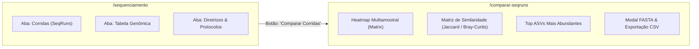

# 🧬 Módulo de Sequenciamento e Comparador de Seq Runs

Nota anterior: [[02 - Domínio Científico e Biológico]] | Próxima nota: [[04 - Modelagem de Dados e Tipos TypeScript]]

> **Atenção:** Este é o módulo em desenvolvimento ativo na branch `feature/kaua/pagina_comparacao_seq_runs`. Ele representa o diferencial bioinformático da plataforma.

---

## 🔬 Visão Geral dos Dois Módulos Genômicos

---

## 📊 Arquitetura de `CompareSeqRunsPage.tsx`

Arquivo fonte: [CompareSeqRunsPage.tsx](file:///C:/Users/k246165/Documents/system/fungus_garden_web_front/src/pages/CompareSeqRunsPage.tsx)  
Estilos: [CompareSeqRunsPage.css](file:///C:/Users/k246165/Documents/system/fungus_garden_web_front/src/pages/CompareSeqRunsPage.css)

### 1. Estados Principais (Controle Reativo)

| Estado | Tipo | Descrição |
| :--- | :--- | :--- |
| `selectedRunIds` | `string[]` | IDs das corridas selecionadas para compor as colunas do heatmap |
| `metricMode` | `'relative' \| 'count' \| 'log10'` | Métrica renderizada nas células (Abundância %, Contagens brutas ou escala $\log_{10}$) |
| `colorPalette` | `'green-yellow-red' \| 'green-red' \| 'red-yellow-green'` | Gradiente de cores do mapa de calor |
| `viewMode` | `'matrix' \| 'similarity' \| 'top-asvs'` | Modo de visualização ativo |
| `searchTerm` | `string` | Busca textual por nome do organismo ou linhagem taxonômica |
| `asvTypeFilter` | `'all' \| 'Bacteria' \| 'Fungo'` | Filtro por domínio/reino biológico |
| `sortBy` | Enum de ordenação | Ordenar por abundância decrescente, presença compartilhada ou nome alfabético |

---

### 2. Modos de Visualização

#### A. Modo Matriz (Heatmap ASVs × Amostras)
- Linhas representam as **ASVs únicas** encontradas no universo das amostras selecionadas.
- Colunas representam as **Corridas de Sequenciamento (SeqRuns)**.
- O cruzamento calcula a intensidade da cor proporcionalmente ao valor máximo da métrica selecionada.
- **Sticky Headers:** Coluna de nomes de ASVs fixada à esquerda e cabeçalho de amostras fixado no topo para scroll suave em matrizes grandes.

#### B. Modo Matriz de Similaridade Ecológica
Compara a distância ecológica entre cada par de amostras ($i, j$):
1. **Índice de Jaccard (Presença/Ausência):**
   $$J(A, B) = \frac{|A \cap B|}{|A \cup B|}$$
   Avalia a sobreposição de táxons compartilhados entre as amostras.
2. **Similaridade de Bray-Curtis (Abundância Ponderada):**
   $$BC_{ij} = 1 - \frac{2 \sum \min(c_{ik}, c_{jk})}{\sum c_{ik} + \sum c_{jk}}$$
   Leva em conta não apenas a presença, mas a abundância relativa de cada ASV.

#### C. Modo Top ASVs
- Ranking consolidado das ASVs mais abundantes somando todas as corridas selecionadas.
- Exibe barras de progresso taxonômicas coloridas e badge de confiança taxonômica (%).

---

### 3. Modal de Detalhes da ASV & Exportadores
- Ao clicar em qualquer linha da matriz, abre-se o modal com:
  - **Sequência FASTA:** Visualização monospaçada com botão de cópia de um clique (`Copy`).
  - **Taxonomia Completa:** Níveis detalhados de Reino a Espécie.
  - **Função Ecológica:** Descrição curada do papel biológico da ASV na colônia.
- **Exportação:**
  - `Exportar CSV`: Gera arquivo tabular contendo ASV ID, Taxonomia e valores por corrida.
  - `Exportar FASTA`: Consolida todas as sequências filtradas em formato padrão `.fasta`.

---

## 🧪 Dados Mockados em `src/data/seqRuns.ts`

As corridas de sequenciamento mockadas representam cenários ecológicos realistas:

1. **`SEQRUN-2024-16S-01`**:
   - *Target:* 16S V4 (Illumina MiSeq)
   - *Amostra:* Cutícula de operárias maiores (soldados) de *Atta sexdens*.
   - *Destaque:* Alta abundância de *Pseudonocardia formicarum* (42.5%) e *Streptomyces* (18.2%).
2. **`SEQRUN-2024-ITS-02`**:
   - *Target:* ITS1 (Illumina NovaSeq 6000)
   - *Amostra:* Jardim de fungo central (câmara de forrageamento).
   - *Destaque:* Predomínio absoluto do cultivar *Leucoagaricus gongylophorus* (86.4%).
3. **`SEQRUN-2024-16S-02`**:
   - *Target:* 16S V3-V4 (PacBio Sequel II - leituras longas)
   - *Amostra:* Criptas propleurais de *Acromyrmex subterraneus*.
4. **`SEQRUN-2024-META-01`**:
   - *Target:* Metagenoma Shotgun (Oxford Nanopore)
   - *Amostra:* Lixo da colônia (*waste chamber*), rico em patógenos degradados e bactérias decompositoras.
