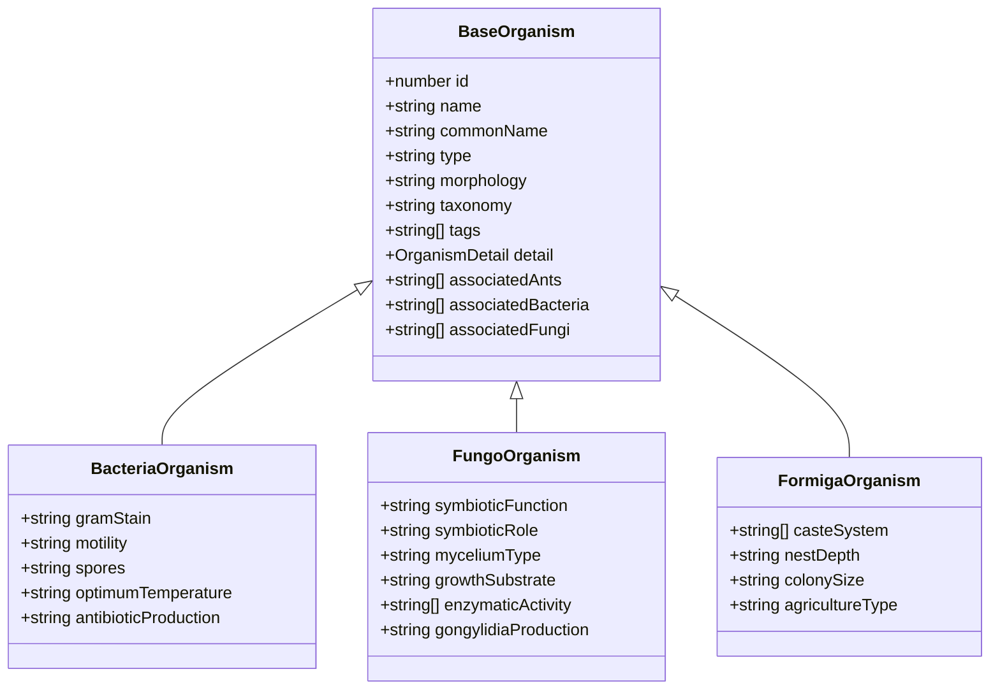
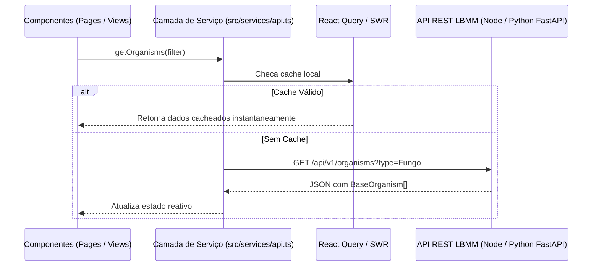

# 📐 Modelagem de Dados e Tipos TypeScript

Nota anterior: [[03 - Módulo de Sequenciamento e Comparador de Seq Runs]] | Próxima nota: [[05 - Guia do Desenvolvedor e Git Workflow]]

Arquivo central: [types/index.ts](file:///C:/Users/k246165/Documents/system/fungus_garden_web_front/src/types/index.ts)

---

## 🏛️ Hierarquia e Tipos Discriminados

O sistema utiliza **Discriminated Unions** (uniões discriminadas) em TypeScript com base na propriedade literal `type: 'Bacteria' | 'Fungo' | 'Formiga'`. Isso garante segurança de tipo ao renderizar dados morfológicos específicos de cada reino biológico.



---

## 🔬 Interfaces de Dados Genômicos e ASVs (`seqRuns.ts`)

```typescript
export interface ASVItem {
  id: string;                 // Ex: 'ASV_16S_001'
  sequence: string;           // Sequência nucleotídica (FASTA)
  length: number;             // Comprimento em pares de bases (bp)
  taxonomy: string;           // String no padrão GreenGenes/SILVA (k__; p__; ...)
  organismName: string;       // Nome binomial curado
  type: 'Bacteria' | 'Fungo' | 'Formiga' | 'Outros';
  count: number;              // Leituras brutas (raw read count)
  relativeAbundance: number;  // Abundância relativa percentual (%)
  confidence: number;         // Score de confiança da classificação (0-100%)
  description?: string;       // Papel ecológico e relevância no LBMM
}

export interface SeqRun {
  id: string;                 // Identificador da corrida (ex: 'SEQRUN-2024-16S-01')
  title: string;              // Título do experimento
  date: string;               // Data de sequenciamento
  targetRegion:               // Marcador amplificado
    | '16S V4' | '16S V3-V4' | 'ITS1' | 'ITS2' | '18S rRNA' | '16S Full Length' | 'Metagenoma Shotgun';
  platform:                   // Equipamento de sequenciamento
    | 'Illumina MiSeq' | 'Illumina NovaSeq 6000' | 'Oxford Nanopore GridION' | 'PacBio Sequel II';
  sampleSource: string;       // Espécie / hospedeiro de origem
  environment: string;        // Microambiente biológico coletado
  totalReads: number;         // Total de leituras válidas pós-controle de qualidade
  totalAsvs: number;          // Riqueza observada de variantes
  shannonIndex: number;       // Diversidade alfa ($H'$)
  chao1Index: number;         // Estimador de riqueza ($S_{chao1}$)
  description: string;        // Metadados do projeto
  asvs: ASVItem[];            // Lista de variantes detectadas
}
```

---

## 🔄 Estratégia de Transição: Mocks ➔ API Backend

Atualmente, os componentes importam dados estáticos de `src/data/organisms.ts` e `src/data/seqRuns.ts`.

Para a próxima fase do projeto (marcada no Trello como *📝 A Fazer*), a transição seguirá este fluxo:



### Contratos dos Endpoints Planejados:
1. `GET /api/v1/organisms`: Listagem paginada com suporte a query params (`?search=`, `?type=`, `?reino=`).
2. `GET /api/v1/organisms/:id`: Detalhes completos com `OrganismDetail`.
3. `GET /api/v1/seqruns`: Lista sumarizada de corridas metagenômicas.
4. `GET /api/v1/seqruns/compare`: Recebe lista de IDs (`?ids=run1,run2`) e devolve matriz consolidada calculada no servidor para conjuntos de dados de larga escala.
