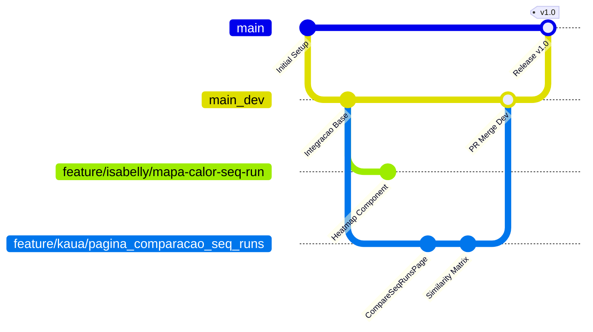
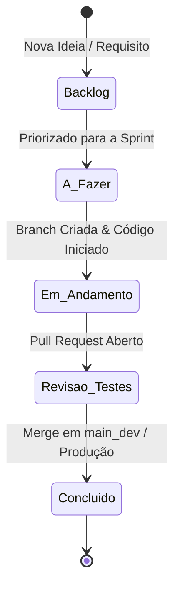

# 🚀 Guia do Desenvolvedor e Git Workflow

Nota anterior: [[04 - Modelagem de Dados e Tipos TypeScript]] | Retornar ao início: [[00 - Visão Geral e Mapa Mental]]

---

## 🌳 Modelo de Branches (Gitflow do LBMM)

O repositório opera com o seguinte fluxo de ramificação:



* **`main`:** Versão de produção, espelhada nos servidores oficiais da UNESP.
* **`main_dev`:** Branch de integração onde todas as features são consolidadas e testadas em conjunto.
* **`feature/<nome>/<funcionalidade>`:** Branches de trabalho individual isoladas.

---

## 🧹 Checklist de Higiene e Correção do Git

### 1. Remoção do Arquivo Espúrio `12.0.2`
No commit recente `0dd6ed5`, um arquivo chamado `12.0.2` contendo log de erro de comando npm foi acidentalmente commitado na raiz do repositório. Para corrigi-lo:

```bash
git rm 12.0.2
git commit -m "chore: remove arquivo espurio 12.0.2 gerado por erro de comando"
git push origin feature/kaua/pagina_comparacao_seq_runs
```

### 2. Padronização de Autoria nos Commits
Para evitar discrepâncias entre contas (`kauahsa` vs `KauaAndrade-Unicamp`), fixe sua assinatura oficial nas configurações do Git:

```bash
git config user.name "Kauã Henrique"
git config user.email "kauaestudosprog@gmail.com"
```

---

## 💻 Comandos e Scripts do Projeto

| Comando | Ação |
| :--- | :--- |
| `npm run dev` | Inicia o servidor de desenvolvimento local no Vite (`http://localhost:5173`) |
| `npm run build` | Executa o compilador TypeScript (`tsc -b`) e gera o bundle minificado em `dist/` |
| `npm run preview` | Testa localmente a compilação final idêntica à de produção |
| `npm run lint` | Executa o ESLint verificando regras de hooks, variáveis não utilizadas e tipos |

---

## 📌 Integração com o Trello

O fluxo de tarefas é espelhado no quadro [MicrobioBase - Fungus Garden](https://trello.com/b/A6oQEd7i/microbiobase-fungus-garden):



* **Ao iniciar uma tarefa:** Arrastar o cartão para **"Em Andamento"** e vincular o nome da branch na descrição.
* **Ao abrir Pull Request:** Mover o cartão para **"Revisao e Testes"** e adicionar o link do PR no GitHub.
* **Ao concluir o merge:** Mover para **"Concluido"**.
