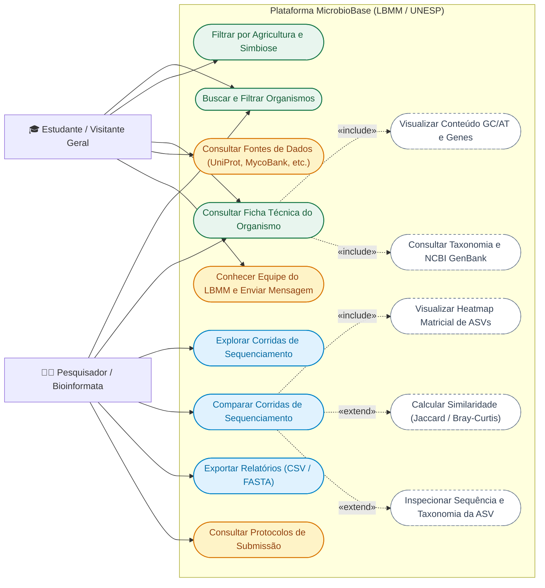

# 👥 06 - Diagrama de Casos de Uso e Atores

Nota anterior: [[05 - Guia do Desenvolvedor e Git Workflow]] | Retornar ao índice: [[00 - Visão Geral e Mapa Mental]]

> 🎨 **Arquivo Nativo Draw.io Disponível:**  
> O diagrama abaixo também está modelado e editável no formato nativo do Draw.io:  
> 📁 `Diagrama_Casos_de_Uso.drawio` (compatível com [app.diagrams.net](https://app.diagrams.net/) e extensão Draw.io do VS Code).

---

## 🗺️ Diagrama de Casos de Uso (UML / Mermaid)

---

## 🎭 Perfil dos Atores

### 1. 🎓 Estudante / Visitante Geral
* **Objetivo:** Conhecer a biodiversidade do jardim de fungo, estudar a simbiose das formigas atíneas e consultar dados taxonômicos e morfológicos.
* **Principais Ações:**
  - Busca textual livre e filtros por tipo biológico (Fungo, Bactéria, Formiga).
  - Filtragem por sistemas agrícolas (Basal, Levedura, Fungos Corais, Cortadeiras).
  - Visualização da ficha técnica com anel interativo de proporção GC/AT.
  - Consulta aos dados institucionais do laboratório (Equipe e Fontes).

### 2. 👨‍🔬 Pesquisador / Bioinformata
* **Objetivo:** Analisar criticamente a estrutura das comunidades microbianas das colônias de formigas, cruzar perfis de amplicons e gerar dados para publicações científicas.
* **Principais Ações:**
  - Inspeção das corridas de sequenciamento NGS (16S rRNA e ITS).
  - Seleção multiamostral para montagem dinâmica de Heatmap de abundância de ASVs.
  - Cálculo de índices ecológicos de diversidade alfa (Shannon, Chao1) e beta (Jaccard e Bray-Curtis).
  - Inspeção de sequências nucleotídicas brutas (FASTA) de variantes raras ou dominantes.
  - Exportação de dados consolidados em formatos tabulares (`.csv`) e multifasta (`.fasta`).

---

## 📋 Mapeamento Funcional por Rota da SPA

| Caso de Uso | Rota Frontend | Componente Responsável |
| :--- | :--- | :--- |
| Busca & Filtros Taxonômicos | `/buscar` | [SearchPage.tsx](file:///C:/Users/k246165/Documents/system/fungus_garden_web_front/src/pages/SearchPage.tsx) + `TaxonomyFilter` |
| Ficha do Organismo & Genômica | `/organismo/:id` | [DetailPage.tsx](file:///C:/Users/k246165/Documents/system/fungus_garden_web_front/src/pages/DetailPage.tsx) |
| Lista de Corridas NGS | `/sequenciamento` | [SequenciamentoPage.tsx](file:///C:/Users/k246165/Documents/system/fungus_garden_web_front/src/pages/SequenciamentoPage.tsx) |
| Comparador Multiamostral & Heatmap | `/comparar-seqruns` | [CompareSeqRunsPage.tsx](file:///C:/Users/k246165/Documents/system/fungus_garden_web_front/src/pages/CompareSeqRunsPage.tsx) |
| Apresentação da Equipe | `/time` | [TeamPage.tsx](file:///C:/Users/k246165/Documents/system/fungus_garden_web_front/src/pages/TeamPage.tsx) |
| Bancos de Dados Parceiros | `/fontes` | [DataSourcesPage.tsx](file:///C:/Users/k246165/Documents/system/fungus_garden_web_front/src/pages/DataSourcesPage.tsx) |
